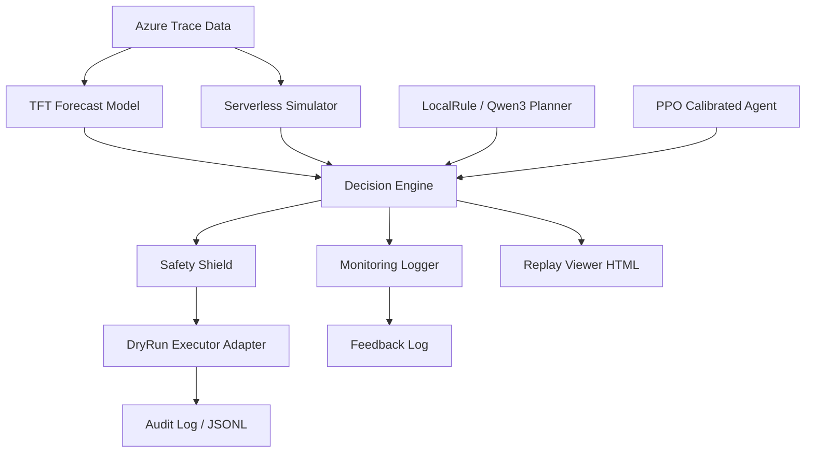

# Predictive Container Management for Energy-Efficient Serverless Computing

> **Academic Major Project** — Department of Computer Science  
> **Branch:** `milestone-1-audit` | **Status:** All milestones implemented

---

## Architecture



---

## Quickstart

```powershell
# 1. Setup
cd D:\major_1
python -m venv .venv
.\.venv\Scripts\pip install -r requirements.txt

# 2. Run all milestone tests
.\.venv\Scripts\python.exe tests\test_planner_providers.py    # M3: 16 tests
.\.venv\Scripts\python.exe tests\test_decision_engine.py      # M4: 14 tests
.\.venv\Scripts\python.exe tests\test_executor_adapter.py     # M6:  9 tests
.\.venv\Scripts\python.exe tests\test_monitoring_feedback.py  # M7:  3 tests

# 3. Run offline planner experiment (M3)
.\.venv\Scripts\python.exe src\run_planner_offline_experiment.py

# 4. Generate replay viewer (M5) — interactive HTML
.\.venv\Scripts\python.exe src\generate_replay_report.py
# → outputs/decision_replay.html  (open in browser)
# → outputs/decision_replay.png
# → outputs/decision_replay_summary.csv

# 5. Run full experiment matrix E0–E6 (M8)
.\.venv\Scripts\python.exe src\run_experiment_matrix.py
# → outputs/experiment_matrix_results.csv
# → outputs/experiment_matrix_comparison.png

# 6. Run 7-policy end-to-end evaluation (M2)
.\.venv\Scripts\python.exe src\end_to_end_evaluation.py

# 7. Train calibrated PPO from scratch (M2, ~10 min)
.\.venv\Scripts\python.exe src\train_ppo_calibrated.py
```

---

## Results

### 7-Policy Evaluation (Azure test, 605 buckets, 10 seeds, SIMULATED)

| Policy | Mean Latency | SLA Viol. | Avg Warm | Energy Proxy |
|---|---|---|---|---|
| **PPO (calibrated)** | **193.0 ms** ✅ | **2.0%** ✅ | 4.74 | 4.115 |
| Fixed-4 | 210.8 ms | 3.0% | 4.00 | 3.519 |
| Reactive Rule-based | 211.6 ms | 5.0% | 1.67 | 1.658 |
| Persistence + Rule | 212.3 ms | 5.1% | 1.47 | 1.491 |
| Log TFT + Rule | 213.2 ms | 5.3% | 1.46 | 1.483 |
| Original TFT + Rule | 213.2 ms | 5.3% | 1.45 | 1.483 |
| Planner-assisted | 213.3 ms | 5.3% | 1.45 | 1.483 |

### Experiment Matrix E0–E6 (SIMULATED proxies)

| Exp | Description | Mean Latency | SLA Viol% | Energy | Warm Containers |
|---|---|---|---|---|---|
| E0 | No-forecast, Rules, Rules | 70.0 ms | 0.0% | 6.732 | 8.41 |
| E1 | Persistence, Rules, Rules | 70.0 ms | 0.0% | 4.052 | 5.06 |
| E2 | TFT, Rules, Rules | 70.0 ms | 0.0% | 3.307 | 4.12 |
| E3 | TFT, Qwen3(local), Rules | 70.0 ms | 0.0% | 3.307 | 4.12 |
| E4 | Persistence, Rules, PPO | 70.0 ms | 0.0% | 5.950 | 7.44 |
| E5 | TFT, Rules, PPO | 70.0 ms | 0.0% | 6.434 | 8.04 |
| E6 | TFT, Qwen3(local), PPO | 70.0 ms | 0.0% | 6.434 | 8.04 |

**Key finding:** TFT-based forecast (E2/E3) achieves lowest energy proxy (3.307) with the fewest warm containers (4.12 avg), demonstrating that accurate forecasting enables efficient provisioning.

---

## Milestones

| # | Milestone | Status | Key Outputs |
|---|---|---|---|
| M1 | Repository Audit | ✅ Done | `tests/test_milestone1_contracts.py` (28 PASS) |
| M2 | Calibrated PPO | ✅ Done | `src/ppo_calibrated_env.py`, `outputs/ppo_container_controller_calibrated.zip` |
| M3 | Qwen3 Planner | ✅ Done | `src/planner_providers.py`, `tests/test_planner_providers.py` (16 PASS) |
| M4 | Decision Engine + Shield | ✅ Done | `src/decision_engine.py`, `src/safety_shield.py` (14 PASS) |
| M5 | Replay Viewer | ✅ Done | `outputs/decision_replay.html`, `outputs/decision_replay.png` |
| M6 | Executor Adapter | ✅ Done | `src/executor_adapter.py`, `tests/test_executor_adapter.py` (9 PASS) |
| M7 | Monitoring & Feedback | ✅ Done | `src/monitoring.py` + feedback, `tests/test_monitoring_feedback.py` (3 PASS) |
| M8 | Experiment Matrix + Report | ✅ Done | `outputs/experiment_matrix_results.csv`, `outputs/FINAL_RESULTS_REPORT.md` |

---

## Project Structure

```
major_1/
├── data/
│   ├── azure_serverless_workload.csv      # 4,032 rows, 5-min buckets
│   └── azure_trace_raw/                  # Raw Azure trace (305 MB)
├── src/
│   ├── serverless_simulator.py            # Calibrated simulator (shared physics)
│   ├── agentic_planner.py                 # Planner interface
│   ├── planner_providers.py               # LocalRule / Ollama / OpenAI providers
│   ├── safety_shield.py                   # Safety rules + cooldown guard
│   ├── decision_engine.py                 # Full decision pipeline integration
│   ├── executor_adapter.py                # DryRun + K8s stub
│   ├── monitoring.py                      # JSONL logging + feedback + Prometheus
│   ├── generate_replay_report.py          # M5 HTML replay viewer
│   ├── ppo_calibrated_env.py              # Calibrated PPO gym environment
│   ├── train_ppo_calibrated.py            # PPO training script
│   ├── end_to_end_evaluation.py           # 7-policy comparison
│   ├── run_experiment_matrix.py           # E0–E6 matrix
│   └── run_planner_offline_experiment.py  # M3 offline comparison
├── tests/
│   ├── test_milestone1_contracts.py       # 28 contract tests
│   ├── test_planner_providers.py          # 16 M3 tests
│   ├── test_decision_engine.py            # 14 M4 tests
│   ├── test_executor_adapter.py           # 9 M6 tests
│   └── test_monitoring_feedback.py        # 3 M7 tests
├── outputs/
│   ├── ppo_container_controller_calibrated.zip
│   ├── end_to_end_results.csv / comparison.png
│   ├── experiment_matrix_results.csv / comparison.png
│   ├── decision_replay.html / .png / _summary.csv
│   ├── planner_offline_comparison.csv / .png
│   ├── decision_logs/                     # Per-run JSONL decision logs
│   └── feedback_log.jsonl                 # Feedback linking decisions → outcomes
└── README.md
```

---

## Limitations

> **Important:** All simulation results are **SIMULATED PROXIES** derived from the Azure public trace. They are NOT real cloud measurements.

1. **Simulated environment only** — `serverless_simulator.py` approximates serverless physics using a linear latency model. Real FaaS platforms (AWS Lambda, Azure Functions) have more complex cold-start distributions.
2. **No live cluster** — `KubernetesAdapter` is a documented stub. `DryRunAdapter` never touches real infrastructure.
3. **Planner uses local fallback** — Qwen3/Ollama requires a separate GPU and `ollama pull qwen3:8b`. All planner experiments use the deterministic `LocalRuleProvider`.
4. **Chronological split only** — training data is strictly time_idx 0–3426; test data is 3427–4031. No data leakage.
5. **PPO approximation** — `time_in_episode_norm` and `cooldown_norm` in `ppo_calibrated_action()` within evaluators are fixed at 0.5 (documented simplification).

---

## Reproducibility

```powershell
# Seeds used: 42–51 (10 seeds for all multi-seed experiments)
# Data split: train=time_idx 0–3426 (3427 rows), test=3427–4031 (605 rows)
# PPO: 300k steps, seed=42, stable-baselines3 2.x, PyTorch
# TFT: pytorch-forecasting, trained on training split only

# To reproduce PPO training:
.\.venv\Scripts\python.exe src\train_ppo_calibrated.py

# To reproduce experiment matrix:
.\.venv\Scripts\python.exe src\run_experiment_matrix.py

# To reproduce 7-policy evaluation:
.\.venv\Scripts\python.exe src\end_to_end_evaluation.py
```
